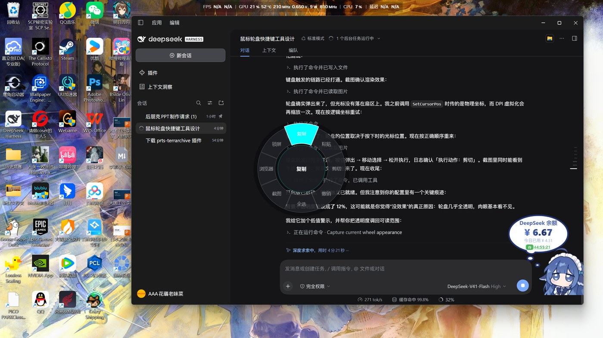
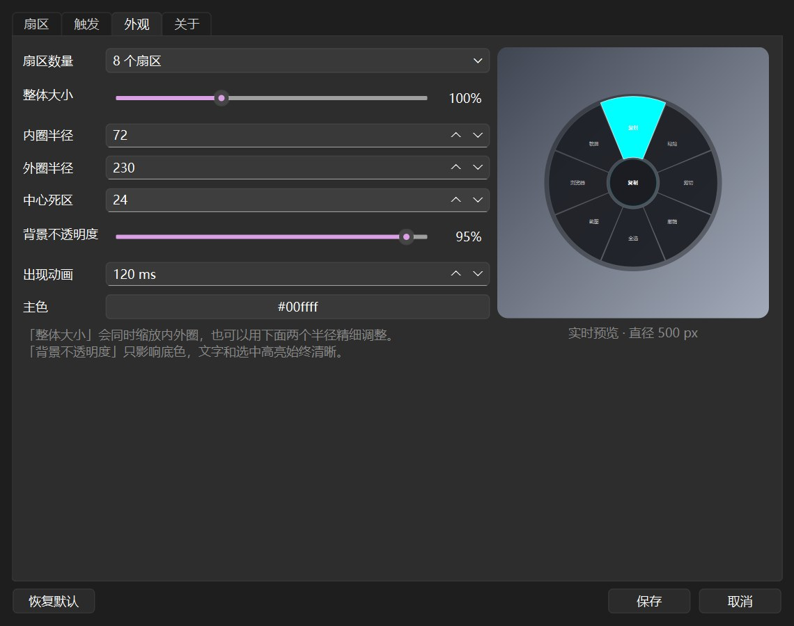
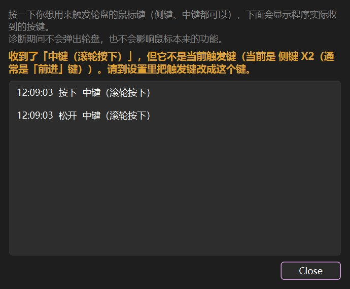

# FLO 快捷轮盘

> 按住鼠标侧键，光标旁弹出环形菜单，划到想要的扇区松手即执行。
> Windows 11 托盘常驻小工具，开机自启，不抢焦点、不打断工作流。



一个扇区一件事：快捷键、常用文本、打开程序、打开网址、媒体键、系统动作、运行命令。
全部在图形界面里配，改完保存立即生效。

---

## 特性

- **按住触发，松开执行**：按住侧键 180ms 弹出，划到扇区松手生效；快速点一下则保留原功能（X1 在浏览器里照样后退）
- **两种触发方式**：鼠标侧键 X1 / X2 / 中键，或任意键盘组合键（键盘触发同样是按住-松开）
- **8 种动作类型**：快捷键、输入文本、启动程序、打开网址、媒体键、系统动作、运行命令、空
- **外观可调**：扇区数 4/6/8/12、整体大小 50%–200%、背景不透明度 0–100%、主色、出现动画，**带实时预览**
- **不抢焦点**：轮盘窗口不激活、不吃点击，快捷键永远发给原来那个窗口
- **开机自启**：写入当前用户注册表 Run 项，普通权限，不弹 UAC；被移动过会自动修正路径
- **配置健壮**：原子写入、自动备份 5 份、损坏自愈、旧版本配置自动迁移
- **自带诊断**：按侧键没反应时，用「检测鼠标按键」看程序到底收到了什么

| 设置界面 | 检测鼠标按键 |
|---|---|
|  |  |

---

## 下载

到 [Releases](../../releases) 页下载最新的 `FLO-Wheel-v*.zip`，解压后双击 `FLO-Wheel.exe` 即可，
不需要安装，也不需要 Python。

首次运行会：

1. 在托盘中出现一个蓝色圆环图标
2. 自动写入开机自启（可在 设置 → 关于 里关掉）
3. 在 `%APPDATA%\MouseWheel\` 生成配置文件（沿用旧目录名，升级不会丢配置）

---

## 使用方法

1. **按住**鼠标侧键（默认 X1，约 0.2 秒）→ 轮盘在光标旁弹出
2. 保持按住，把鼠标**划向某个扇区** → 该扇区高亮
3. **松开** → 执行；想反悔就划回中心再松开，或按 `Esc`

> 中心半径 24px 是**取消区**：按住后如果鼠标没往外划，松手等于取消（什么都不做）。

快速点一下触发键（不到 180ms）不会弹轮盘，程序会把这次点击原样还给系统。

托盘图标右键菜单：打开设置、启用/暂停、重新载入配置、检测鼠标按键、打开配置文件夹、退出。

---

## 设置

托盘右键 →「打开设置…」，改完点「保存」立即生效，不用重启。

| 页 | 内容 |
|---|---|
| **扇区** | 左边选扇区，右边改名称、动作类型和参数。扇区按 12 点方向顺时针编号 |
| **触发** | 鼠标触发键（X1 / X2 / 中键）、键盘触发键、按住判定时长、快速点击是否放行 |
| **外观** | 扇区数量、整体大小、内外圈半径、中心死区、背景不透明度、出现动画、主色 |
| **关于** | 开机自启动开关、配置文件位置、日志位置 |

### 动作类型

| 类型 | 说明 |
|---|---|
| 快捷键 | 任意组合键，例如 `Ctrl+Shift+S`、`Win+Shift+S`、`Alt+F4`；支持"重复 N 次" |
| 输入文本 | 通过剪贴板粘贴，中文、表情、长段落都稳定；默认用完恢复原剪贴板 |
| 启动程序 | 程序 / 文件 / 文件夹的完整路径 |
| 打开网址 | 用默认浏览器打开 |
| 媒体键 | 音量 ±、静音、播放/暂停、上下曲 |
| 系统动作 | 锁屏、截图、显示桌面、任务管理器、资源管理器、睡眠 |
| 运行命令 | cmd 或 PowerShell，后台执行不闪窗口 |
| 空 | 只显示名字，松手不做任何事 |

### 调大小和透明度

「外观」页右侧是实时预览，拖滑块立刻能看到效果，下方标注实际直径。

| 控件 | 作用 |
|---|---|
| 整体大小 | 50%–200%，等比缩放内外圈；100% 对应直径 500px |
| 背景不透明度 | 0%–100%，只影响扇区底色和外围暗底；**文字和选中高亮始终不透明** |
| 内圈 / 外圈半径 | 精细调整，和整体大小滑块双向同步 |

### 键盘触发键（可选）

适合没有侧键的鼠标，或侧键被驱动占用的情况。行为和侧键完全一致：
按住组合键 → 弹出 → 移动鼠标选 → 松开 → 执行。

实现用的是低级键盘钩子（`WH_KEYBOARD_LL`），**只观察、从不吞键**，
所以不会抢占任何系统快捷键。

推荐组合：`Ctrl+Alt+Q`、`Alt+F9`、`F13`。留空即关闭。

---

## 配置文件

位置：`%APPDATA%\MouseWheel\config.json`（关于页有「打开」按钮）

- 每次保存前自动备份为 `config.json.bak`、`.bak2`… 最多 5 份
- 文件损坏时不会崩溃：坏文件另存为 `.broken`，自动回落到默认配置
- 手动改完可以在托盘菜单点「重新载入配置」
- 便携模式：在 exe 同目录放一个空的 `portable.flag`，配置就存到 exe 旁边的 `data\` 里

---

## 已知限制

1. **对以管理员身份运行的程序无效**。普通权限程序无法向提权窗口发送按键（Windows 的 UIPI 机制）。
   本版本有意不做提权，以避免每次开机弹 UAC。
2. **独占全屏游戏**（尤其带反作弊的网游）里钩子可能失效，建议用托盘菜单「暂停」。
3. **触发键只支持侧键和中键**。左键/右键刻意不支持：那两键一旦被当作触发键，
   钩子会吞掉它们，鼠标就点不了任何东西了。

---

## 故障排查

### 按侧键没反应 → 用「检测鼠标按键」

托盘右键 →「检测鼠标按键…」（设置 → 触发 页也有同名按钮）。按一下你想用的键：

| 显示 | 含义 | 怎么办 |
|---|---|---|
| 有记录，标着「← 当前触发键」 | 按键和配置都正常 | 问题在别处，检查松手时是否划出了中心区 |
| 有记录，提示「它不是当前触发键」 | **设置里选错了键**（X1/X2 记反最常见） | 按提示把触发键改成它 |
| **完全没有记录** | 按键事件没到程序 | 鼠标驱动（G HUB / Synapse）把它映射成宏或键盘事件了 |

诊断期间不会弹轮盘，也不影响鼠标原本的功能。

### 其他

- **日志**：`%LOCALAPPDATA%\MouseWheel\logs\mousewheel.log`
  正常启动应该能看到「鼠标钩子已安装」；弹出时会记录「轮盘弹出」；执行时记录「执行动作」。
- **快捷键没生效**：个别老程序需要更长的按键间隔，可以改用「运行命令」。
- **轮盘太透明看不见**：外观页把「背景不透明度」拉到 60% 以上（低于 25% 时数字会变橙色警示）。

---

## 开发

需要 Python 3.10+。

```powershell
# 创建独立环境
python -m venv .venv
.venv\Scripts\pip install PySide6-Essentials pytest pyinstaller

# 直接运行
$env:PYTHONPATH = "src"
python -m mousewheel --settings      # 启动并打开设置
python -m mousewheel --demo          # 只显示轮盘（不挂钩子，调试渲染）
python -m mousewheel --log-level DEBUG

# 单元测试（98 项）
python -m pytest tests -q

# 打包 + 安装 + 重启
powershell -ExecutionPolicy Bypass -File tools\build.ps1
```

### 代码结构

```
src/mousewheel/
  __main__.py          入口与命令行参数
  app.py               控制器：钩子 → 状态机 → 轮盘 → 动作
  input/
    mouse_hook.py      WH_MOUSE_LL 钩子线程（只投递，绝不做重活）
    key_hook.py        WH_KEYBOARD_LL 钩子线程（键盘触发键）
    trigger.py         长按 / 快击 / 切换 状态机（纯逻辑，有单测）
    key_combo.py       组合键"是否全按住"判定（纯逻辑，有单测）
    inject.py          SendInput：按键序列、点击重放
    hotkey_spec.py     "Ctrl+Shift+S" ⇄ 虚拟键码
  wheel/
    geometry.py        角度 ⇄ 扇区（纯函数，有单测）
    renderer.py        QPainter 画环形菜单
    overlay.py         透明置顶窗口 + 光标轮询
  actions/             各动作实现与分派
  config/              数据模型、原子读写、默认值
  ui/                  托盘、设置窗口、扇区编辑、检测鼠标按键
  platform/win/        Win32 底座：winapi / 剪贴板 / 自启动 / 单实例 / DPI
```

### 三条铁律（改代码前必读）

1. **钩子回调里不许 `SendInput`** —— 会重入。一律投递到主线程再发。
2. **钩子回调里不许做耗时操作** —— 超过 ~300ms Windows 会静默摘掉钩子。
3. **注入事件必须带 `dwExtraInfo = MAGIC_EXTRA_INFO`** —— 否则钩子会把自己的注入当成用户输入，形成自触发。

### 测试

```powershell
python -m pytest tests -q
```

覆盖：扇区几何、触发状态机、组合键判定、快捷键解析、配置迁移、
渲染像素（透明度/主色真的生效）、设置窗口的保存行为。

端到端脚本（会真的操作鼠标键盘，运行时别动电脑）：

```powershell
python tools\e2e_test.py --button middle --restore   # 验证 钩子→轮盘→动作
python tools\diagnose_preview.py                     # 验证诊断窗口
```

---

## License

[MIT](LICENSE)
